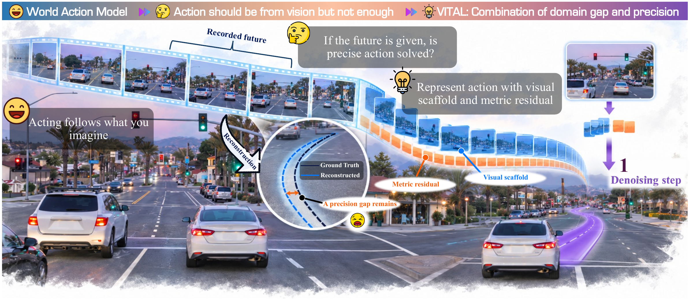
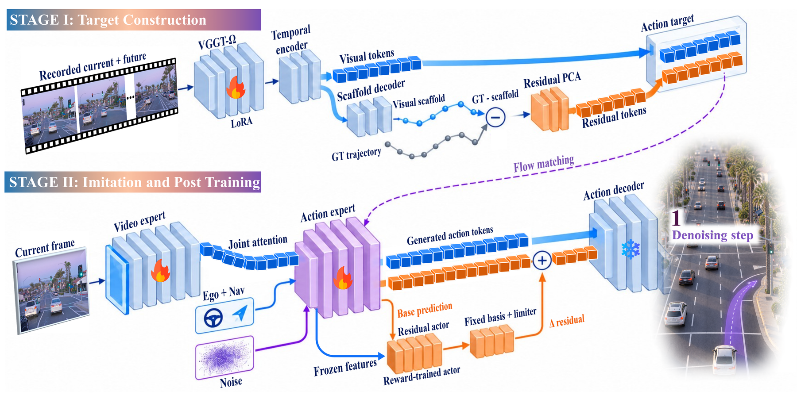

<div align="center">

# VITAL: From Visual Motion to Precise Action

[🌐 Project Page](https://worldbench.github.io/vital.html) · [💻 Code](https://github.com/worldbench/VITAL) · [🤗 Model Weights](https://huggingface.co/datasets/vital-wam/vital/tree/main)

<p>
<a href="https://alanliangc.github.io/" target="_blank" rel="noopener noreferrer">Alan Liang</a><sup aria-label="Affiliations 1,2">1,2</sup><sup aria-label="Intern at Horizon Robotics">*</sup>, <a href="https://scholar.google.com/citations?user=J9a48hMAAAAJ&amp;hl=en" target="_blank" rel="noopener noreferrer">Youquan Liu</a><sup aria-label="Affiliations 2,3">2,3</sup>, <a href="https://lmx760581375.github.io/" target="_blank" rel="noopener noreferrer">Mingxiao Li</a><sup aria-label="Affiliations 1">1</sup>, <a href="https://scholar.google.com/citations?user=br7-IGkAAAAJ&amp;hl=zh-CN" target="_blank" rel="noopener noreferrer">Wei Chow</a><sup aria-label="Affiliations 4">4</sup>, <a href="https://ldkong.com/" target="_blank" rel="noopener noreferrer">Lingdong Kong</a><sup aria-label="Affiliations 4">4</sup><br/>
<a href="https://liaoyue.net/" target="_blank" rel="noopener noreferrer">Yue Liao</a><sup aria-label="Affiliations 4">4</sup>, <a href="https://dylanorange.github.io/" target="_blank" rel="noopener noreferrer">Dongyue Lu</a><sup aria-label="Affiliations 4">4</sup>, <a href="https://yuyang-cloud.github.io/" target="_blank" rel="noopener noreferrer">Yu Yang</a><sup aria-label="Affiliations 5">5</sup>, <a href="https://yvanyin.xyz/" target="_blank" rel="noopener noreferrer">Wei Yin</a><sup aria-label="Affiliations 1">1</sup>, <a href="https://runnanchen.github.io/" target="_blank" rel="noopener noreferrer">Runnan Chen</a><sup aria-label="Affiliations 2">2</sup><sup aria-label="Corresponding author">†</sup>
</p>

<p>
<sup>1</sup> Horizon Robotics, &nbsp;
<sup>2</sup> Shanghai Innovation Institute, &nbsp;
<sup>3</sup> Fudan University<br/>
<sup>4</sup> National University of Singapore, &nbsp;
<sup>5</sup> Zhejiang University
</p>

<p><sup>*</sup> Intern at Horizon Robotics &nbsp;·&nbsp; <sup>†</sup> Corresponding author</p>



</div>


## 🚧 TODO

- [x] Add installation instructions and inference/evaluation examples.
- [x] Release inference code and pretrained checkpoints.
- [ ] Release training code for the action tokenizer, action expert, and residual refinement.
- [ ] Add training examples and reproduction instructions.

## 🔍 Overview

VITAL derives action targets from visual motion. It pairs a visually grounded motion scaffold with a normalized metric residual, giving small trajectory corrections their own learning scale.

At deployment, the action expert jointly predicts both components from the current front-camera image, ego state, and navigation command. One flow evaluation produces a four-second trajectory. A bounded residual actor refines execution while keeping the predicted visual scaffold fixed.



## 📊 Results

All results below use **one action evaluation (NFE = 1)** and **one generated trajectory**.

| Benchmark | Split | Metric | VITAL |
| :--- | :--- | :--- | ---: |
| NAVSIM v1 | navtest | PDMS | **90.8** |
| NAVSIM v2 | navtest | EPDMS | **91.1** |
| NAVSIM v2 | navhard | EPDMS | **38.6** |

The NAVSIM v2 results transfer the v1-trained policy without retraining. End-to-end inference takes **149 ms**, compared with **490 ms** for ten evaluations (**3.29×** speedup), at batch size one on an RTX 4090, including image encoding and residual correction.

## 🚀 Inference and Evaluation

This release provides one-step trajectory inference, pretrained weights, and
evaluation with the official **NAVSIM v1 PDMS** protocol.
Training code is planned; see the checklist above.

The workflow below installs the environment, downloads model weights and
public data, runs a four-scene end-to-end check, and evaluates the complete
navtest split. Run commands from the repository root. Paths can be overridden
with the corresponding command-line options.

### 1. Install the environment

The reference environment is Linux, Python 3.12, PyTorch 2.10.0,
torchvision 0.25.0, CUDA 12.6, NumPy 1.26.4 and BF16 inference. Allow at least
32 GB of system RAM. GPU memory must accommodate approximately 13 GB of model
parameters plus activations; the recorded inference checks used a 48 GB GPU.

```bash
conda create -n vital python=3.12 -y
conda activate vital
python -m pip install --upgrade pip
python -m pip install torch==2.10.0 torchvision==0.25.0 --index-url https://download.pytorch.org/whl/cu126
python -m pip install -r requirements.txt
python -m pip install -e .
```

For metric-cache generation and official PDMS scoring, also install the pinned
NAVSIM and nuPlan devkits. `--no-deps` prevents their historical dependency
pins from replacing the PyTorch environment above. These packages are not
required for inference alone.

```bash
python -m pip install --no-deps "nuplan-devkit @ git+https://github.com/motional/nuplan-devkit.git@nuplan-devkit-v1.2"
python -m pip install --no-deps "navsim @ git+https://github.com/autonomousvision/navsim.git@0811876c274e8b058ab2be9b3dcd4d37bd23f177"
python -m pip install -r requirements-scoring.txt
```

### 2. Download model weights

Three files are required for inference:

| Component | Source | Download size |
| --- | --- | --- |
| VITAL policy, adapters, decoder and residual policy | [vital-wam/vital](https://huggingface.co/datasets/vital-wam/vital/tree/main) | 2.05 GB |
| Trained WAN visual backbone | [SimWAM](https://huggingface.co/H-EmbodVis/SimWAM/blob/a862a0dc8576be777872c128266a5573d8ae3c40/weights/SimWAM.pt) | 12.04 GB |
| Image VAE | [Wan2.2](https://huggingface.co/Wan-AI/Wan2.2-TI2V-5B/blob/921dbaf3f1674a56f47e83fb80a34bac8a8f203e/Wan2.2_VAE.pth) | 2.82 GB |

Download VITAL:

```bash
vital-download-weights --output checkpoints/vital.pt
```

The command uses the published Hugging Face URL automatically, pins revision
`046f00531d306a287f19f0f825108761728cff38`, and verifies the downloaded file.
The source archive contains no model weights. The Hugging Face repository is
registered as a dataset repository but contains the VITAL checkpoint only.

Review the [SimWAM model terms](https://huggingface.co/H-EmbodVis/SimWAM) and
[WAN model terms](https://huggingface.co/Wan-AI/Wan2.2-TI2V-5B), then download
the public backbone and VAE:

```bash
vital-download-upstream --output checkpoints/upstream --accept-model-terms
vital-verify-weights checkpoints/vital.pt --upstream-dir checkpoints/upstream
```

Use the pinned trained SimWAM backbone: vanilla WAN DiT and SimWAM-RL are not
interchangeable with it. Only the visual expert is read from the SimWAM
checkpoint. A separate SimWAM code checkout and text encoder are unnecessary.

After download:

```text
checkpoints/
  vital.pt
  upstream/
    SimWAM.pt
    Wan2.2_VAE.pth
```

See [Weights](docs/WEIGHTS.md) for direct download commands, exact revisions,
checksums, mirror settings, and reuse of existing files.

### 3. Download public NAVSIM data

For NAVSIM v1 navtest, obtain the test metadata, front-camera images and nuPlan
maps from their providers. Review the [OpenScene dataset](https://huggingface.co/datasets/OpenDriveLab/OpenScene),
[nuPlan dataset terms](https://motional-nuplan.s3-ap-northeast-1.amazonaws.com/LICENSE),
and [NAVSIM installation guide](https://github.com/autonomousvision/navsim/blob/0811876c274e8b058ab2be9b3dcd4d37bd23f177/docs/install.md)
before downloading:

```bash
vital-download-data --output data/navsim --accept-data-terms
```

The downloader retrieves test logs, 32 camera archive shards, and maps. Camera
archives contain the public test camera data; inference reads CAM_F0 only.
Training data and LiDAR are not required. Reserve enough disk space for both
extracted data and temporary archives. Components can also be downloaded
separately:

```bash
vital-download-data --output data/navsim --components logs maps --accept-data-terms
vital-download-data --output data/navsim --components cameras --accept-data-terms
```

An existing licensed download can be used with the following layout:

```text
data/navsim/
  navsim_logs/test/<log>.pkl
  sensor_blobs/test/<log>/CAM_F0/<image>.jpg
  maps/nuplan-maps-v1.0.json
  maps/<map-region>/<version>/map.gpkg
```

Set `--data-root` to the dataset directory if it is stored elsewhere.
The reader loads official pickle logs, so use trusted dataset files only.

### 4. Run a four-scene end-to-end check

After completing the downloads, run inference on four scenes:

```bash
vital-infer --data-root data/navsim --weights checkpoints/vital.pt \
  --limit 4 --output outputs/smoke_predictions.npz
```

Generate metric caches for the same deterministic subset, then score the
predictions. These commands require the scoring dependencies from section 1.

```bash
vital-prepare-metrics --data-root data/navsim --cache data/metric_cache_smoke --limit 4
vital-score --predictions outputs/smoke_predictions.npz \
  --cache data/metric_cache_smoke --output outputs/smoke_scores.csv
```

The outputs are trajectories in `outputs/smoke_predictions.npz`, per-scene
scores in `outputs/smoke_scores.csv`, and a summary in
`outputs/smoke_scores.json`. This small check verifies the inference/scoring
workflow; its score is not expected to match the full benchmark result.

Inference and scoring refuse to overwrite existing prediction/CSV outputs.
Use new output paths when repeating a run. Metric-cache generation reuses
existing caches.

### 5. Evaluate the complete navtest split

```bash
vital-infer --data-root data/navsim --weights checkpoints/vital.pt \
  --output outputs/navtest_nfe1.npz
vital-prepare-metrics --data-root data/navsim --cache data/metric_cache
vital-score --predictions outputs/navtest_nfe1.npz \
  --cache data/metric_cache --output outputs/navtest_scores.csv
```

The full split contains **12,146 scenes**. Inference checks full-split coverage;
scoring requires a metric cache for every predicted token. The score CSV and
`outputs/navtest_scores.json` are generated from the new predictions. Cache
construction can be time-consuming.

The paper reference for this checkpoint and protocol is **90.8326 PDMS
(90.8 rounded), NFE=1**. PDMS is 100 times the mean official per-scene score,
not the product of averaged components. These commands implement NAVSIM v1
PDMS; NAVSIM v2 EPDMS and reactive NAVHARD use different evaluation protocols.

For a custom subset, pass the same newline-separated token file using
`--tokens` to both `vital-infer` and `vital-prepare-metrics`. Tokens must belong
to the public navtest split. A subset result is not a full benchmark result.

### Inference protocol

The current CAM_F0 image is resized without cropping to 384 × 672 and
normalized to [-1, 1]. Ego velocity, acceleration, and the four-way navigation
command form the eight-dimensional state. Each scene uses one action-head
evaluation and CPU noise seed 0, producing 40 ego-local poses
`[x forward, y left, yaw]` at 0.1-second intervals. Future images and ground
truth trajectories are not model inputs.

The NPZ output contains plain-string `tokens`, `poses` with shape `[N, 40, 3]`,
`nfe`, and `sampling_interval_s`; load it with `allow_pickle=False`.
Normalization statistics, the decoder basis, and the constant prompt embedding
are stored in the checkpoint. The model configuration also comes from the
checkpoint; `configs/inference.yaml` is a reference, not a runtime config file.

### Validation and documentation

CPU checks require the installed package and run without downloading data:

```bash
python -m unittest discover -s tests -v
```

The checkpoint-dependent test is skipped when `checkpoints/vital.pt` is absent.
See [Validation](docs/VALIDATION.md) for numerical checks and their limits,
[Architecture](docs/ARCHITECTURE.md) for the package layout, and
[Development](docs/DEVELOPMENT.md) for static checks and builds.

Third-party code and model attribution is recorded in
[THIRD_PARTY_NOTICES.md](THIRD_PARTY_NOTICES.md) and
[checkpoint notices](docs/WEIGHT_NOTICES.md). Source distributions contain code,
documentation and public split metadata. Model weights and licensed datasets
are downloaded separately; metric caches and evaluation outputs are generated
locally.

## 📖 Citation

The arXiv identifier will be added when available. Until then, use this project citation:

```bibtex
@misc{liang2026vital,
  title = {VITAL: From Visual Motion to Precise Action},
  author = {Alan Liang and Youquan Liu and Mingxiao Li and Wei Chow and Lingdong Kong and Yue Liao and Dongyue Lu and Yu Yang and Wei Yin and Runnan Chen},
  year = {2026},
  url = {https://worldbench.github.io/vital.html}
}
```
